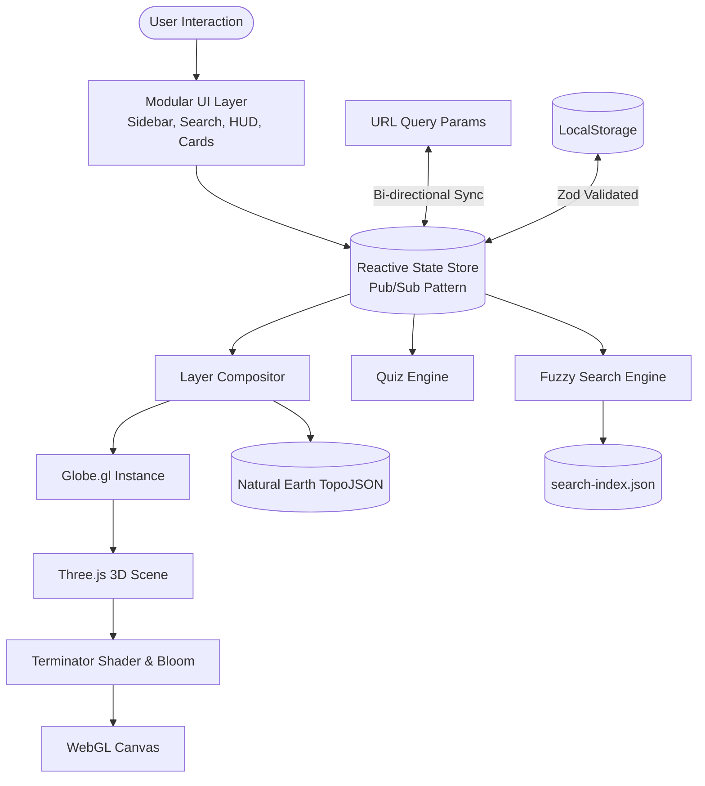

# TerraLearn 🌍

[](https://github.com/Tomoneczek/terralearn/actions/workflows/ci.yml)
[](https://github.com/Tomoneczek/terralearn/actions/workflows/deploy.yml)
[](https://www.typescriptlang.org/)
[](https://github.com/Tomoneczek/terralearn)
[](https://opensource.org/licenses/MIT)

> **Interactive 3D Earth globe web application for physical and political geography exploration, spatial perception, and gamified learning.**  
> 🔗 **Live Demo:** [https://tomoneczek.github.io/terralearn/](https://tomoneczek.github.io/terralearn/)  
> 📖 **Engineering Case Study:** [`docs/case-study.md`](./docs/case-study.md)

---

## 🌟 Overview & Motivation

Traditional web maps rely almost universally on cylindrical projections (such as Web Mercator EPSG:3857), which severely distort sizes, distances, and shapes away from the equator. Greenland appears larger than the entire African continent (despite Africa being 14 times larger), and polar navigation routes appear completely counter-intuitive.

**TerraLearn** is built from first principles on a true 3D spherical datum using **WebGL**, **Three.js**, and **Globe.gl**. It provides an engaging, educational platform to discover real planetary geography with 60 FPS performance, offline-first data, and zero commercial tracking.

---

## ✨ Key Features

- 🌐 **True 3D Spherical Exploration:** Accurate planetary proportions, smooth orbital camera controls, auto-rotation, and interactive picking across all continents and oceans.
- 🗺️ **Comprehensive Physical & Political Layers:**
  - **Political:** Country borders, Top-N rankable countries (area/population), capitals, and logarithmic-scaled megacities (>10M residents).
  - **Physical:** Major mountain ranges, highest continental peaks, world deserts, major river networks (with animated dash flow), and top lakes.
- 🌗 **Real-Time Day/Night Illumination:**
  - Astronomical subsolar calculation using the **Meeus Solar Algorithm** (solar declination $\delta$ and equation of time).
  - Custom GLSL terminator shader seamlessly blending daytime albedo with nighttime city light emissions across the twilight band.
  - Atmospheric glow powered by a selective **UnrealBloomPass** with automated frame rate degradation protection.
- 🎯 **Blind Map Challenge ("Ślepa mapa"):**
  - Gamified spatial quiz prompting players to pinpoint countries, peaks, rivers, and lakes on an unlabelled globe.
  - Precise **Haversine great-circle distance** calculation between click and target coordinates.
  - 3D visual error arcs rendered directly on the sphere with color feedback.
  - Score degradation formula with direct-hit bonuses, achievement badges, and mistake repetition mode.
- 🔍 **Sub-Millisecond Fuzzy Search & Rich InfoCards:**
  - Multi-field diacritic-insensitive search index indexing 2,050+ geographical items.
  - Animated camera fly-to on selection with custom altitude and pitch.
  - Rich information cards providing population, area, elevation, length, and real-world scale comparisons (e.g. comparing Lake Baikal's surface area to European countries).
- ⚙️ **Shareable State & Deep Linking:**
  - Bi-directional URL synchronization (`?layers=borders,lakes:10&mode=physical&lat=52&lng=19`) for instant bookmarking and sharing.
  - Safe LocalStorage persistence validated at runtime using **Zod** schemas.
- 🌐 **Strict i18n Isolation:**
  - English source code and architecture with Polish user-facing localization.
  - Automated CI checker (`scripts/check-i18n.ts`) strictly enforcing zero hardcoded Polish diacritics outside `src/i18n/`.

---

## 🏗️ System Architecture



For an exhaustive technical breakdown of the architectural decisions, see the [`docs/case-study.md`](./docs/case-study.md).

---

## 🔬 Mathematical Highlights

### 1. Haversine Great-Circle Distance

To compute error distances on the sphere without planar projection bias:

$$d = 2 R \cdot \arcsin\left(\sqrt{\sin^2\left(\frac{\Delta\phi}{2}\right) + \cos(\phi_1)\cos(\phi_2)\sin^2\left(\frac{\Delta\lambda}{2}\right)}\right)$$

Where $R = 6,371.0088\text{ km}$ is Earth's mean volumetric radius.

### 2. Meeus Astronomical Solar Coordinates

Subsolar coordinates are calculated dynamically from the current UTC timestamp:

- **Fractional Year ($\gamma$):** accounts for leap years and orbital eccentricity.
- **Solar Declination ($\delta$):** dictates current seasonal latitude tilt ($+23.44^\circ$ at Northern Summer Solstice).
- **Equation of Time (EoT):** aligns solar noon longitude with the Greenwich prime meridian.

---

## 🚀 Getting Started

### Prerequisites

- **Node.js:** `>= 20.10.0` (managed via `.nvmrc`)
- **npm:** `>= 10.x`

### Installation

```bash
# Clone the repository
git clone https://github.com/Tomoneczek/terralearn.git
cd terralearn

# Use the recommended Node.js version
nvm use

# Install dependencies
npm ci
```

### Development & Build Commands

| Command                 | Description                                                           |
| ----------------------- | --------------------------------------------------------------------- |
| `npm run dev`           | Starts local development server at `http://localhost:3000`            |
| `npm run build`         | Compiles TypeScript and builds optimized production bundle in `dist/` |
| `npm run preview`       | Previews production build locally with static file serving            |
| `npm run check`         | Runs full quality suite: `typecheck` + `lint` + `check:i18n` + `test` |
| `npm run test`          | Executes unit and integration test suite via Vitest                   |
| `npm run test:coverage` | Generates detailed test coverage report (enforcing $\ge 80\%$)        |
| `npm run check:i18n`    | Asserts zero leaked Polish diacritics in source files                 |
| `npm run data:build`    | Rebuilds and compresses TopoJSON assets and search index              |

---

## 📦 Bundle Optimization & Performance

TerraLearn is optimized for fast loading and low memory footprint:

- **Modular Code Splitting:** `rollupOptions.output.manualChunks` cleanly isolates the heavy Three.js graphics engine into `three-vendor`, keeping the core application bundle under **68 KB (18.8 KB gzip)**.
- **Quantized TopoJSON:** Natural Earth vector shapefiles are filtered, converted to TopoJSON, and quantized, reducing payload size by **over 94%** (< 2.4 MB total for the entire planetary dataset).
- **Decoupled Hover Pipeline:** Visual highlights update shader uniform accessors directly, bypassing costly polygon re-triangulation and maintaining steady 60 FPS.

---

## 📚 Data Attributions & Sources

TerraLearn is powered entirely by openly licensed, public-domain datasets:

- **Natural Earth:** Continental borders, physical features, populated places, and landforms (Public Domain).
- **KSNG:** Polish endonyms and geographical designations standardized by the Polish Commission on Standardization of Geographical Names Outside the Republic of Poland.
- **NASA Visible Earth:** Blue Marble daytime and nighttime city lights planetary albedo textures (Public Domain).

---

## 📄 License

This project is licensed under the [MIT License](LICENSE).
