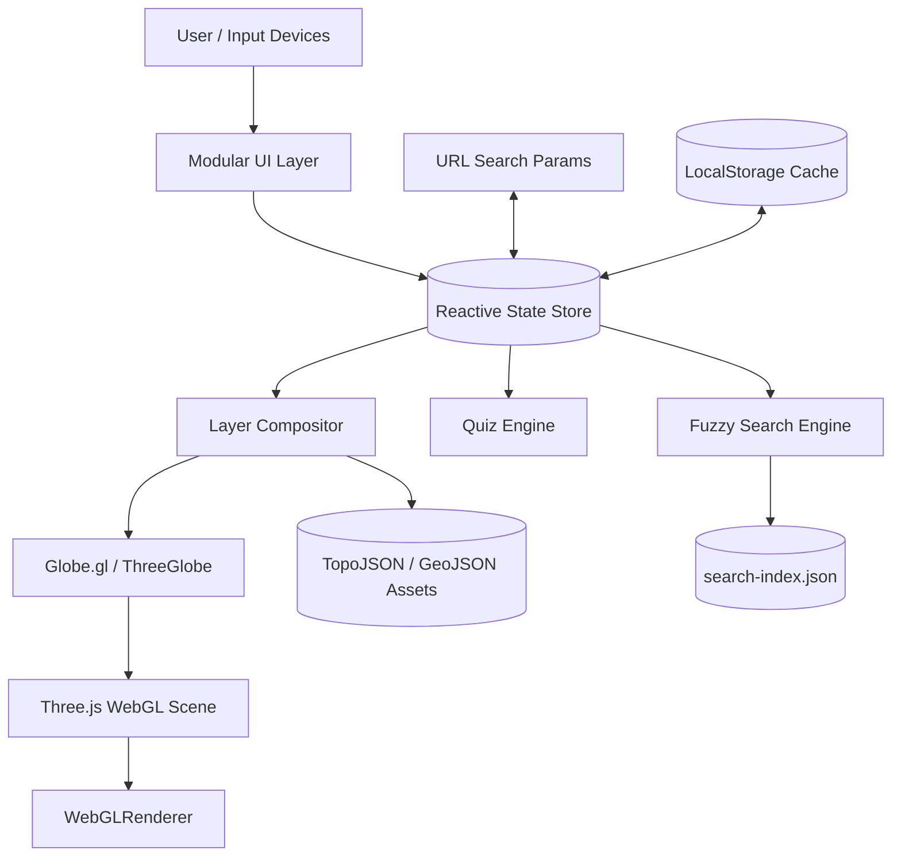

# TerraLearn – Engineering Case Study & Technical Deep-Dive

## 1. Executive Summary

**TerraLearn** is an interactive, browser-based 3D Earth globe created as an educational platform and portfolio project. It addresses a fundamental flaw in traditional digital geography tools: the distortion of areas, distances, and shapes caused by flat Mercator projections.

By rendering planetary geography directly on a spherical datum using WebGL, Three.js, and Globe.gl, TerraLearn delivers true spatial relationships alongside smooth 60 FPS rendering, day/night solar illumination, and a gamified spatial recall quiz engine.

---

## 2. Core Architectural Principles

### 2.1 Decoupled Reactive State Machine

State management follows an immutable pub/sub pattern inspired by Redux and Nano Stores without any heavyweight external dependencies:

- **`Store<T>`**: Atomically notifies subscribers only when a subscribed sub-tree selector changes value.
- **Bi-directional URL Synchronization**: State flags (active layers, top-N rank thresholds, day/night mode) serialize transparently to browser URL query parameters (`?layers=borders,lakes:10&mode=physical`), enabling frictionless deep linking and sharing.
- **Zod Runtime Validation**: Persisted configuration in `localStorage` is guarded by strict schema validation, ensuring graceful rollback on corrupt or outdated payload formats.

### 2.2 Layer Composition Pipeline

Rendering thousands of vector contours, polygons, and labels simultaneously on a 3D sphere presents acute performance challenges. The `LayerCompositor` manages:

1. **Altitude Hierarchy (Z-Order)**:
   - Polygons (Borders / Countries): Altitude `0.001`
   - Lakes / Water Bodies: Altitude `0.003`
   - Rivers: Altitude `0.004` (animated dash stroke)
   - Mountain Ranges: Altitude `0.006`
   - Point Features (Peaks, Capitals, Megacities): Altitude `0.010` - `0.025`
2. **Proximity Decluttering**:
   - Label density is dynamically managed through priority thresholds and bounding proximity tests, preventing unreadable label clusters.
3. **Decoupled Interaction Rendering**:
   - Mouse hover and selection states mutate visual uniforms directly via fast accessor methods (`refreshDynamicStyles()`), eliminating expensive re-composition of TopoJSON geometry.

---

## 3. Mathematical & Algorithmic Foundations

### 3.1 Haversine Great-Circle Distance

For the blind map quiz evaluation, user click coordinates $(\phi_1, \lambda_1)$ are measured against true target coordinates $(\phi_2, \lambda_2)$ using the spherical Haversine formula:

$$\Delta\sigma = 2 \arcsin\left(\sqrt{\sin^2\left(\frac{\Delta\phi}{2}\right) + \cos(\phi_1)\cos(\phi_2)\sin^2\left(\frac{\Delta\lambda}{2}\right)}\right)$$

$$d = R \cdot \Delta\sigma$$

Where:

- $R \approx 6,371.0088\text{ km}$ (mean Earth volumetric radius)
- $\Delta\phi = \phi_2 - \phi_1$
- $\Delta\lambda = \lambda_2 - \lambda_1$

### 3.2 Astronomical Solar Illumination (Meeus Algorithm)

To project the realistic day/night terminator without external API queries, subsolar coordinates $(\delta, \alpha)$ are calculated on-the-fly based on UTC time:

- **Fractional Year $(\gamma)$**: accounts for leap years and orbital eccentricity.
- **Solar Declination $(\delta)$**: determines current seasonal latitude ($+23.44^\circ$ at Northern Summer Solstice, $-23.44^\circ$ at Winter Solstice).
- **Equation of Time (EoT)**: corrects solar noon longitude relative to the Greenwich meridian.

A custom GLSL fragment shader smoothly blends daylight albedo textures with high-resolution nighttime city lights across the twilight band ($90^\circ \pm 6^\circ$ civil twilight).

---

## 4. Performance & Production Engineering

| Dimension                   | Challenge                           | Solution                                                                     | Result                                            |
| --------------------------- | ----------------------------------- | ---------------------------------------------------------------------------- | ------------------------------------------------- |
| **Data Footprint**          | Natural Earth vectors exceed 45 MB  | TopoJSON quantization, Douglas-Peucker simplification, river network merging | Total data size **< 2.4 MB** (94.7% reduction)    |
| **Frame Stability**         | Heavy polygon re-renders drop FPS   | Cached Three.js materials, decoupled hover states, adaptive quality tiers    | Consistent **60 FPS** on standard integrated GPUs |
| **Bundle Splitting**        | Three.js & Globe.gl are heavyweight | `rollupOptions.output.manualChunks` split into `three-vendor` and `vendor`   | Core application bundle **67 KB (18.8 KB gzip)**  |
| **Zero Diacritics Leakage** | Mixed-language pollution in code    | Custom AST scanner `scripts/check-i18n.ts` in pre-commit and CI              | 100% strict separation of code & i18n             |

---

## 5. Security & Privacy

- **Zero Third-Party APIs**: All geographic data, textures, and assets are hosted statically offline.
- **No Analytics / No Cookies / No Tracking**: Complete privacy compliance.
- **Strict Content Security Policy (CSP)**: Enforced via `public/_headers` preventing cross-site scripting (XSS), inline evaluation, and malicious iframe embedding.
